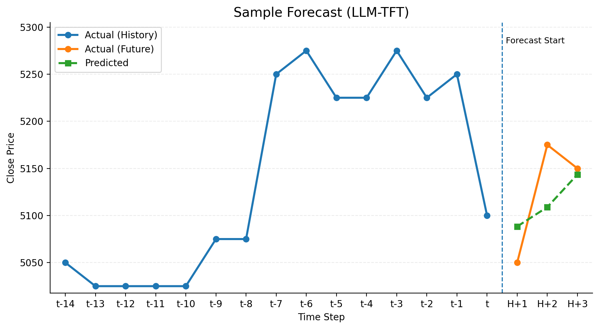

# LLM-Enhanced Temporal Fusion Transformer for Indonesian Stock Forecasting

Undergraduate thesis, Informatics, Universitas Diponegoro (2026). Paper co-authored and presented at the
9th International Conference on Informatics and Computational Sciences (ICICoS 2026).

This project forecasts the closing prices of four Indonesian blue-chip stocks (ASII, BBRI, BMRI, TLKM) one to
three trading days ahead. It compares a baseline Temporal Fusion Transformer (TFT) with an LLM-enhanced TFT that
also receives daily financial-news sentiment labelled by an LLM.

## Results (test set, 3,672 forecasts)

| Model | RMSE | MAE | MAPE | R² | Directional Accuracy |
| --- | --- | --- | --- | --- | --- |
| Baseline TFT | 132.58 | 96.16 | 2.26% | 0.9863 | 52.3% |
| **LLM-TFT** | **125.29** | **91.02** | **2.13%** | **0.9878** | **58.3%** |
| Change | −5.5% | −5.3% | −5.7% | +0.0015 | +5.9 pts |

The LLM-TFT had lower RMSE, MAE and MAPE and higher R² for every ticker and every horizon (H1–H3), and higher
directional accuracy in 11 of the 12 ticker-horizon pairs. Full breakdowns are in
[`reportss/`](reportss/).



## How it works

1. **News collection**: RSS feeds (Tempo, CNN Indonesia, CNBC Indonesia, Kompas, Kumparan, Kontan, Yahoo Finance)
   and Google News.
2. **Sentiment labelling**: each article is labelled per ticker from three sources (an LLM via the OpenAI API, a
   market-reaction rule and a financial lexicon) and combined by majority vote, then aggregated per ticker per day.
3. **Prices and features**: daily prices from Yahoo Finance (2017 to January 2026), technical indicators and
   calendar features.
4. **Modelling**: two TFTs trained with PyTorch Forecasting and Lightning (15-day encoder, 3-day horizon), one
   without and one with the sentiment features.
5. **Evaluation**: RMSE, MAE, MAPE, R² and directional accuracy per ticker and horizon, plus attention-based
   comparison.

**Stack:** Python, pandas, PyTorch, PyTorch Forecasting, Lightning, OpenAI API, yfinance, feedparser, Streamlit,
Plotly.

## Quick start

```bash
pip install -r requirements.txt
export OPENAI_API_KEY=...        # only needed to re-label news sentiment
bash scripts/run_end_to_end.sh   # data collection -> labelling -> training -> evaluation
streamlit run src/dashboard/app.py
```

---

## Dokumentasi pipeline (Bahasa Indonesia)

Pipeline ringkas untuk labeling sentimen multi-sumber dan membangun dataset TFT.

## Prasyarat
- Python 3.10+
- Dependency utama: `pandas`, `pyyaml`, `feedparser`, `yfinance`, `requests`,
  `beautifulsoup4` (install via `pip install -r requirements.txt`).
- Variabel lingkungan `OPENAI_API_KEY` terisi (untuk L_text via GPT). Jika ingin hanya
  menjalankan agregasi tanpa GPT, pastikan `data/processed/news_with_sentiment_per_article.csv`
  sudah ada terlebih dahulu.
- File input yang dibutuhkan (akan dihasilkan otomatis jika menjalankan pipeline lengkap):
  - `data/interim/news_clean.csv`
  - `data/interim/prices_with_indicators.csv`

## Perintah cepat dari terminal
Jalankan dari root repo (folder ini). Seluruh langkah sudah diringkas dalam skrip
berikut:

```bash
bash scripts/run_sentiment_pipeline.sh
```

Skrip tersebut menjalankan tiga modul secara berurutan:

1. **Label berita per artikel & ticker**
   ```bash
   python -m src.data.gpt_sentiment_labeling
   ```
   Output: `data/processed/news_with_sentiment_per_article.csv` berisi kolom
   `l_text`, `l_market`, `l_lex`, `l_final`, dan `sentiment_conf`.

2. **Agregasi harian**
   ```bash
   python -m src.data.aggregate_daily_sentiment
   ```
   Output: `data/processed/daily_sentiment.csv` dengan agregasi per ticker per hari
   (sudah shifting weekend → Senin).

3. **Bangun master dataset TFT**
   ```bash
   python -m src.data.build_tft_master_dataset
   ```
Output: `data/processed/tft_master.csv` yang siap dipakai untuk training TFT.

## Urutan perintah lengkap: dari pengambilan data sampai evaluasi
Semua dijalankan dari root repo (isi yang sama dengan `scripts/run_end_to_end.sh`).

```bash
# 1) Ambil berita (RSS + Google News, butuh configs/rss.yaml) lalu bersihkan teks
python -m src.data.fetch_news_rss_google
python -m src.data.preprocess_news_text

# 2) Ambil harga & hitung indikator teknikal (butuh configs/data.yaml)
python -m src.data.download_prices_yahoo
python -m src.data.compute_technical_indicators
python -m src.data.check_price_calendar          # opsional, audit kalender

# 3) Labeling sentimen per artikel + agregasi harian (butuh OPENAI_API_KEY)
python -m src.data.gpt_sentiment_labeling
python -m src.data.aggregate_daily_sentiment

# 4) Bangun master dataset TFT (gabung harga + sentimen)
python -m src.data.build_tft_master_dataset

# 5) Training model
python -m src.models.train_tft_baseline
python -m src.models.train_tft_with_sentiment

# 6) Evaluasi + dashboard
python -m src.models.evaluate_results
python -m streamlit run src/dashboard/app.py
```

Atau sekaligus:

```bash
bash scripts/run_end_to_end.sh
```

## Testing cepat
Untuk memastikan modul bisa di-import, jalankan:

```bash
python -m compileall src
```

## Lokasi rumus & aturan sentimen
Semua aturan NEGATIF/NETRAL/POSITIF dan tiga sumber label (L_text, L_market, L_lex) sudah
diterapkan di kode berikut:

* **Kelas polaritas & prompt GPT** – mapping {-1,0,+1} ada di `configs/gpt_sentiment.yaml`.
* **Konfigurasi threshold** – θ (market) dan τ (lexicon) beserta daftar kata keuangan ada di
  `configs/sentiment.yaml`.
* **Unit teks per emiten** – konstruksi `text_for_label` (judul + lead/kalimat relevan) dan
  label GPT/lexicon/market + voting mayoritas → `L_final` & `sentiment_conf` ada di
  `src/data/gpt_sentiment_labeling.py`.
* **Agregasi harian untuk TFT** – rata-rata `L_text`, `L_market`, `L_lex`, `L_final`, hitung
  `news_count`, `pos/neg/neu`, sinyal kuat, rolling/shock, dan ekspor ke
  `data/processed/daily_sentiment.csv` ada di `src/data/aggregate_daily_sentiment.py`.

Dengan menjalankan pipeline di atas, dataset TFT akan memuat fitur sentimen observasi harian
berbasis ketiga sumber tersebut.
